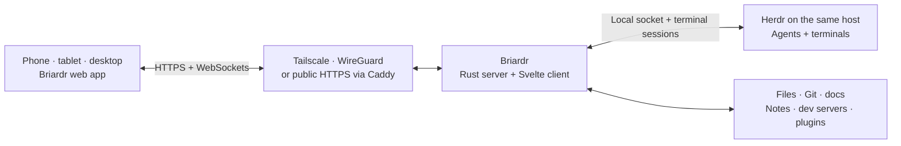

<p align="center">
  
</p>

<h1 align="center">Briardr</h1>
<p align="center"><strong>Your coding agents, from your phone.</strong><br />Watch, answer and steer your Herdr agents from anywhere.</p>

<p align="center">
  <a href="https://github.com/ChrisSku/briardr/releases/latest"></a>
  <a href="LICENSE"></a>
  
  
  
</p>

<p align="center">
  <a href="https://briardr.dev">briardr.dev</a> ·
  <a href="#get-started">Get started</a> ·
  <a href="docs/README.md">Documentation</a> ·
  <a href="CONTRIBUTING.md">Contribute</a> ·
  <a href="https://github.com/ChrisSku/briardr/issues">Issues</a>
</p>

Briardr is a self-hosted **remote window into [Herdr](https://herdr.dev)**. Run it next to Herdr on your
Mac or a Linux server, then check in from a phone, tablet or desktop browser: see which agents need
you, answer or steer them in their real terminals, review their changes, and get out of the way. Work
always lives in Herdr; Briardr shows what Herdr reports and how old it is.

The name comes from the briard, a shaggy French herding dog. Briardr was called Kelpie until October
2026. It is an independent project, built for Herdr.

## What you can do

| | In Briardr |
| --- | --- |
| **See who needs you** | Agents grouped by Needs you, Working and Finished across every workspace, with a badge on the app icon. Peek at a live terminal without taking control or resizing it. |
| **Take the reins** | Open a terminal, answer approvals, send prompts, paste text, upload files and images, and use a touch-friendly key bar. Nothing you type is replayed after a reconnect. Create workspaces, projects, and Claude Code, Codex or shell streams. |
| **Explore the project** | Browse files, search paths, read highlighted code, and collect lines from several files into a question for the agent. Deleting files and folders asks first. |
| **Review the work** | Read the Git diff of every stream and mark files as reviewed. Changes uses read-only Git commands and never takes Git's lock. |
| **Keep context close** | Read the project's Markdown docs and keep notes with images next to a stream; send them to its terminal. |
| **See what is running** | Open a development server in Preview, including WebSockets and hot reload, with zoom controls. |
| **Know when you're needed** | Web Push alerts for questions and finished work, even with the app closed. Payloads are end-to-end encrypted; delivery goes through the browser's push service. |
| **Check usage** | Claude and Codex limits from supported sources, each opt-in. The Claude Keychain source needs a Mac host. |
| **Keep your Mac available** | Optional Always on (screen off, locked or lid closed), battery alerts, Sleep Mac, and on-device dictation (macOS 26 and the Swift toolchain). |
| **Make it yours** | Files, Changes, Preview, Docs, Notes and Usage are plugins you can turn off, built on the same SDK as yours. `briardr create plugin` hands writing a new one to Claude Code or Codex. |

Install Briardr to your Home Screen or Dock, or use it in a browser tab. It opens offline with what it
last saw, labeled stale, adapts to phone, tablet and desktop layouts, and has light and dark themes.

## Get started

You need **Herdr running on the same host as Briardr**, Git, and the tools pinned in
[`mise.toml`](mise.toml) (Bun and Rust, installed by [mise](https://mise.jdx.dev)). The Linux helper
installs its pinned Herdr version; on macOS, install Herdr first with its
[installation guide](https://herdr.dev/docs/install/).

Choose a host and how your devices will reach it:

| Your setup | Start here |
| --- | --- |
| **Mac + Tailscale** | [macOS setup](docs/macos-setup.md): private access on your tailnet, with Tailscale's HTTPS certificates or Briardr's own CA. |
| **Mac + existing WireGuard VPN** | [macOS setup](docs/macos-setup.md) and [WireGuard through a LAN](docs/networking.md#wireguard-through-an-existing-lan). |
| **Ubuntu server + WireGuard** | [Linux deployment](docs/linux-deployment.md#wireguard-access-private-no-domain): a private tunnel the helper sets up. |
| **Ubuntu server + public HTTPS** | [Linux deployment](docs/linux-deployment.md#public-access): your domain, Caddy, and device pairing. |
| **Linux + existing Tailscale** | [Tailscale networking](docs/networking.md#tailscale-on-macos-or-linux): manual setup; the Linux helper manages public HTTPS or WireGuard. |

### Quick start on macOS with Tailscale

Install mise, Herdr and Tailscale first, and connect the Mac and your device to the same tailnet.
Enable [Tailscale HTTPS certificates](https://tailscale.com/docs/how-to/set-up-https-certificates)
and check that `tailscale status --json` works in your terminal.

```sh
git clone --branch v0.1.0 https://github.com/ChrisSku/briardr.git
cd briardr
mise trust
mise install
mise run install
mise run build:server
./server/target/release/briardr configure --mode tailscale --listen tailscale
mise run serve
```

Keep that terminal running. In another terminal in the checkout:

```sh
mise run pair            # one-time code for a new device (also: Settings → Devices → Add a device)
mise run install-agent   # optional: start Briardr at login (prints the launchctl command to run)
```

Open the HTTPS URL it prints on your device and enter the code. On iPhone and iPad, **add Briardr to
the Home Screen first and pair inside the installed app**, then turn on notifications in Settings.
[Device setup](docs/devices.md) covers certificates, installing, and testing alerts.

### Quick start on Ubuntu

As a non-root user with sudo, on Ubuntu 24.04 or 26.04 LTS (x86_64 or aarch64):

```sh
git clone --branch v0.1.0 https://github.com/ChrisSku/briardr.git ~/briardr
cd ~/briardr
scripts/setup-linux.sh check --access wireguard
scripts/setup-linux.sh install --access wireguard --agents claude,codex
scripts/setup-linux.sh wg-add phone
scripts/setup-linux.sh pair
```

The helper installs dependencies, Herdr, the services and the tunnel. Import the phone's WireGuard
configuration, install and trust Briardr's CA, then pair. `wg-add` prints the phone's private key as a
QR code: scan it in your own terminal and keep it out of logs and issues. For a domain without a VPN,
use `install --domain briardr.example.com` instead. Read [Linux deployment](docs/linux-deployment.md)
first for firewall requirements, agent sign-in, backups and current verification limits; to let an
agent on the server do the setup, give it [docs/linux-setup-agent.md](docs/linux-setup-agent.md).

## How it fits together



Herdr owns the terminals and agent processes. Briardr talks to Herdr's control socket on the host,
which is never exposed, and serves the browser app; there is no Briardr account, cloud or relay.
Web Push uses your browser vendor's push service, and optional usage sources contact their provider.
Restarting Briardr leaves Herdr's agents running. The host must stay awake and online for remote
access.

The server is one Rust binary (Tokio, Axum, rustls). The client is Svelte 5 with xterm.js, bundled by
Bun, and installs as a web app with an offline shell. [Architecture](docs/architecture.md) has the
repository map and the safety rules: no input replay, no silent takeover, no Git writes,
authentication on every request, and secrets kept out of logs, each with the tests that hold it.

## Plugins

Files, Changes, Preview, Docs, Notes and Usage are plugins: turn any of them off for every device in
Settings → Plugins. They live in [plugins/](plugins/) and are made exactly like the plugins you write:
the same manifest and nothing from Briardr but `@briardr/sdk` (`test/builtin-plugins.test.ts` holds
them to that). When one needs more from Briardr, the SDK grows, for every plugin. To add your own (a
tab in every stream, a tab of its own or a Settings section, optionally with code running on the
host):

```sh
mise run install-cli     # once: puts `briardr` on your PATH (~/.local/bin)
briardr create plugin    # asks what it should do, then hands the job to Claude Code or Codex
```

`briardr plugin list|link|build|check|enable|disable|dev` manage plugins on the host.
[docs/PLUGINS.md](docs/PLUGINS.md) explains how they work; plugin authors (and their agents) use the
`briardr-plugins` skill that `briardr create plugin` installs (`briardr skill install` installs it alone).

## Status and scope

Briardr is in **early development**; expect rough edges and changes as people try different setups.
macOS and Linux hosts are supported. The Linux helper targets Ubuntu LTS with systemd on x86_64 and
aarch64; other distributions need manual adaptation. Windows hosts aren't supported.

Browser testing focuses on WebKit at iPhone, iPad and desktop sizes. Android and other browser and
device combinations need more testing. Real iPhone Web Push and Home Screen behavior over a WireGuard
IP address with a private CA still need verification; the [Linux guide](docs/linux-deployment.md)
records what has been checked.

Pair only devices you trust: a paired device can operate terminals and delete project files as the
host user. Briardr has no separate user roles or per-project permissions. Read the
[security policy](SECURITY.md) before exposing a deployment.

## Build with us

Bug reports, documentation fixes, device testing and focused pull requests are welcome. Good first
contributions include testing an installation path, improving accessibility, or shortening the way
from an alert to an answer. Start with [Contributing](CONTRIBUTING.md) and the
[development guide](docs/development.md).

```sh
mise run typecheck   # TypeScript and Svelte
mise run build       # the web client
mise run check       # cargo fmt and clippy
mise run test        # Rust unit tests, then integration tests against the binary
mise run test:ui     # WebKit at iPhone, iPad and Mac sizes, light and dark
```

Development and tests use an isolated Herdr session (`briardr-dev`), so your real panes are never touched.
Please report vulnerabilities through [private reporting](SECURITY.md#reporting-a-vulnerability).

## License

[MIT](LICENSE). Dependencies keep their own licenses, and Herdr is a separate project; see
[third-party software](docs/third-party.md).
